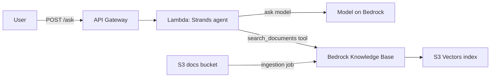

# AWS Knowledge Base Agent

This is my first public AI repo, A small question answering agent for company documents, built on AWS.

You put documents in an S3 bucket. People ask questions over an HTTPS API.
The agent searches the documents, answers using only what it found, and lists
the files it used. If the documents do not cover the question, it says so
instead of guessing.

This pattern is often called RAG (retrieval augmented generation). It is one
of the most common ways companies use AI agents today.

## Example

```
$ python scripts/ask.py "How many days of annual leave can I carry over?"

You can carry over up to 5 unused days of annual leave to the next year.
Carried over days must be used by 31 March or they are lost.

Sources: leave_policy.md
```

## How it works



1. The client sends a question to `POST /ask` with an API key.
2. API Gateway checks the key and the rate limit, then calls the Lambda function.
3. The Lambda function runs an agent built with the
   [Strands Agents SDK](https://strandsagents.com).
4. The agent calls its `search_documents` tool. The tool queries a Bedrock
   Knowledge Base, which finds the best matching passages in S3 Vectors.
5. The model writes the answer from those passages. The API returns the
   answer and the source file names as JSON.

## Project layout

| Path | What it is |
|---|---|
| `agent/handler.py` | Lambda entry point. Checks the request and builds the response. |
| `agent/kb_agent.py` | The agent, its system prompt, and the search tool. |
| `agent/retriever.py` | Calls the Bedrock Knowledge Base. |
| `agent/config.py` | Settings read from environment variables. |
| `infra/stack.py` | All AWS resources, written with AWS CDK in Python. |
| `scripts/build_lambda.py` | Builds the Lambda package. |
| `scripts/load_docs.py` | Uploads documents and indexes them. |
| `scripts/ask.py` | Command line client. |
| `sample_docs/` | Made-up company policies used as demo data. |
| `tests/` | Unit tests. They run without an AWS account. |

## Design choices

- **Serverless and pay per use.** Lambda, API Gateway, S3 Vectors and Bedrock
  all bill by usage. The stack costs close to nothing when nobody uses it.
- **S3 Vectors as the vector store.** It avoids the fixed monthly cost of a
  search cluster, which matters for a small or internal tool.
- **API key and rate limit.** The endpoint is public, so every call needs an
  API key and is limited to 2 requests per second and 500 per day. This keeps
  the model bill under control.
- **Least privilege.** The Lambda role can only query this one knowledge base
  and call the model. The knowledge base role can only read the docs bucket
  and write to its own vector index.
- **Grounded answers.** The system prompt tells the model to search first, to
  use only the passages it found, and to ignore instructions inside documents.
- **Safe errors.** Bad input returns a 400 with a clear message. Internal
  failures are logged and return a generic 502, so no details leak out.

## Run the tests

You need Python 3.13 and Node.js 22 or newer. Node.js is used by AWS CDK.

```bash
python -m venv .venv
source .venv/bin/activate        # on Windows: .venv\Scripts\activate
pip install -r requirements-dev.txt
ruff check .
pytest
```

## Deploy

You also need:

- An AWS account with credentials set up for the AWS CLI.
- The AWS CDK CLI: `npm install -g aws-cdk`.
- Access to the model you want to use and to Titan Text Embeddings V2 in
  Amazon Bedrock, in the region you deploy to.

Steps:

```bash
# 1. Build the Lambda package
python scripts/build_lambda.py

# 2. Create the AWS resources (run 'cdk bootstrap' once per account and region)
cdk bootstrap
cdk deploy

# 3. Upload the sample documents and index them
python scripts/load_docs.py
```

`cdk deploy` prints a few outputs. You need `AskUrl` and `ApiKeyId`.

Get the value of the API key:

```bash
aws apigateway get-api-key --api-key <ApiKeyId> --include-value --query value --output text
```

Ask a question:

```bash
export ASK_URL=<AskUrl>
export ASK_API_KEY=<api key value>
python scripts/ask.py "What is the hotel limit per night?"
```

Or with curl:

```bash
curl -X POST "$ASK_URL" \
  -H "x-api-key: $ASK_API_KEY" \
  -H "Content-Type: application/json" \
  -d '{"question": "What is the hotel limit per night?"}'
```

### Use your own documents

Put your files in a folder and run:

```bash
python scripts/load_docs.py path/to/your/folder
```

Bedrock Knowledge Bases can read text, Markdown, HTML, PDF, Word and other
common formats.

### Choose a model

The default model is Claude Haiku 4.5. You can use any text model on Amazon
Bedrock instead, from Anthropic, Amazon, Meta, Mistral or another provider.
Pass its model id or inference profile id when you deploy:

```bash
cdk deploy -c model_id=amazon.nova-lite-v1:0
```

List the model ids and inference profile ids in your region:

```bash
aws bedrock list-foundation-models --by-output-modality TEXT --query "modelSummaries[].modelId"
```

```bash
aws bedrock list-inference-profiles --query "inferenceProfileSummaries[].inferenceProfileId"
```

Two things to check for the model you pick:

- Your account has access to it in the region you deploy to.
- It supports tool use with the Bedrock Converse API. The agent searches the
  documents through a tool.

## API

`POST /ask`

Request:

```json
{ "question": "How do I report a lost laptop?" }
```

Response `200`:

```json
{
  "answer": "Report it to the IT service desk within 1 hour.",
  "sources": ["it_security_policy.md"]
}
```

Errors:

| Status | When |
|---|---|
| 400 | The body is not JSON, the question is missing, or it is over 1000 characters. |
| 403 | The API key is missing or wrong. |
| 429 | The rate limit or daily quota was reached. |
| 502 | The agent failed. Details are in the Lambda logs. |

## Remove everything

```bash
cdk destroy
```

This deletes all resources, including the documents bucket and its contents.

## Possible next steps

- Keep conversation history so users can ask follow up questions.
- Add Bedrock Guardrails to filter harmful content and personal data.
- Replace the API key with company single sign on.
- Filter search results by department using document metadata.
- Add an evaluation set to measure answer quality after each change.

## License

MIT. See [LICENSE](LICENSE).
